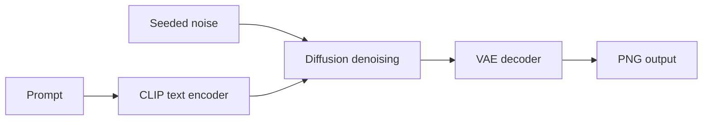
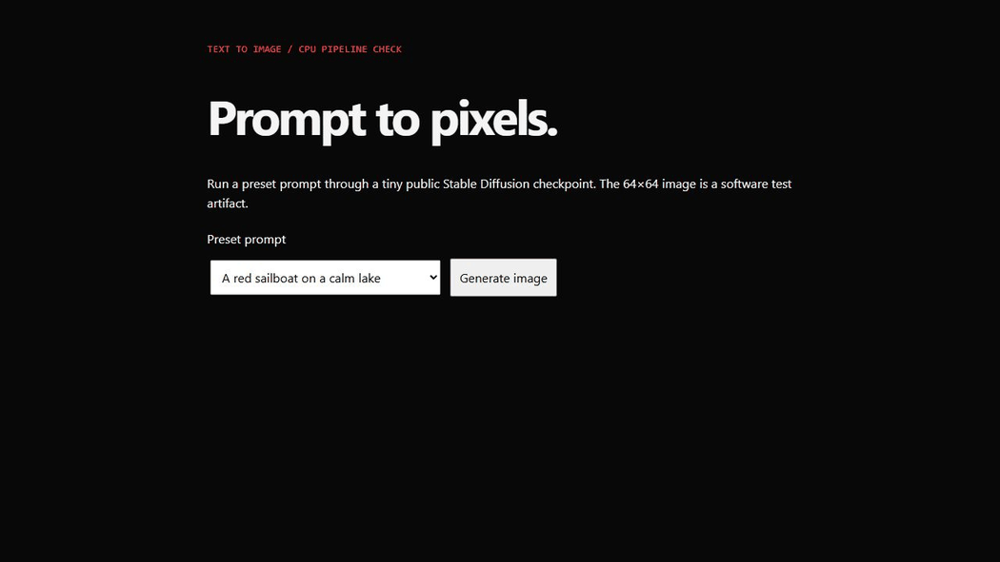

# Text-to-Image with Stable Diffusion

This Colab project explores text-conditioned image generation with Hugging Face Diffusers. The repository URL retains its original name. The notebook imports Stable Diffusion pipelines and uses pretrained models.

## Run the CPU example

Use Python 3.11 or 3.12. Create and activate a virtual environment, then install the CPU build of PyTorch and the remaining requirements:

```bash
python -m pip install torch --index-url https://download.pytorch.org/whl/cpu
python -m pip install -r requirements.txt
python generate.py
```

The first run downloads a pinned public test checkpoint. The script uses SafeTensors and anonymous downloads. It writes `output/smoke.png`; use `python generate.py --offline` to reuse the downloaded files. `--model-dir` can select a different cache directory.



A local CPU run produced a 64×64 PNG using seed 42 and fixture revision `1d6dee47dabc49f0b52d9b1c7a3b6bef244360cb`. The fixture verifies the software path. It is not an evaluation of the image quality of the full models referenced by the notebook.

The [archived notebook](Text_to_Image_Generator.ipynb) uses separate Colab configuration and larger checkpoints. Full-model runs and performance claims require independent reproduction. [Public test checkpoint](https://huggingface.co/hf-internal-testing/tiny-stable-diffusion-pipe-safetensors).

**Tools** · Python, PyTorch, Diffusers, Transformers, SafeTensors.

## See it work



For the preset browser demo and optional free deployment, see [hosting instructions](docs/HOSTING.md).
